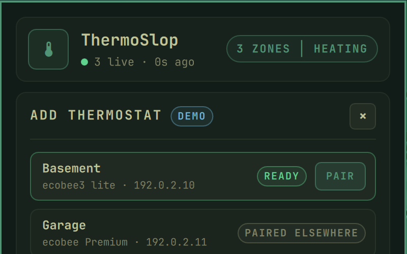

# Omarchy bar widget

The plugin `martellj.thermoslop` shows each thermostat's temperature in the
Omarchy bar, with an icon for heating, cooling or all away. `thermoslop setup`
offers to add it, or add it yourself:

```bash
omarchy plugin add https://github.com/martellj/thermoslop-omarchy --enable
```

{ width="360" }

## The panel (left click)

One card per thermostat, grouped by house:

- the temperature on a ring gauge, and humidity
- a **SET** box with − and +
- its own mode row: **HEAT**, **COOL**, **OFF**, **AWAY** (toggle) and
  **RESUME** (clear the hold), each acting on that thermostat only
- a trend line (24 hours by default) and how far the room is from its target

**The SET box never starts from cached data.** Opening the panel reads each
thermostat (READING…), and − / + stay off until that read succeeds. Presses add
up while you click; about 1.5 seconds after the last one, the exact value is
sent (`thermoslop set 67`, never `+3`). The box shows SAVING…, then what the
thermostat reports back, with a note if it took a different value. Presses made
while saving go out next. A thermostat that can't be reached shows CAN'T READ.

A house with several thermostats gets **AWAY ALL** and **RESUME ALL** beside its
name. They ask to confirm ("AWAY 2 AT HOME?") and run on a second press within
4 seconds. No button changes the mode of several thermostats; for a seasonal
switch use `thermoslop mode heat --all --house home`.

**+ ADD THERMOSTAT** pairs a new one without a terminal: it scans, PAIR starts
pairing, and it asks for the code the thermostat shows at that moment.

{ width="400" }

## Bar clicks

| | |
|---|---|
| right click | away, or resume the schedule if any is away |
| middle click | resume the schedule |
| scroll | setpoint ±1°, the same way as the card's − / + |

Right and middle click act on the one thermostat or the one house the widget
shows. With several houses shown they open the panel instead, and scrolling
works only when the widget shows a single thermostat.

## Settings

On the widget's entry in `~/.config/omarchy/shell.json`:

| Setting | Effect |
|---|---|
| `"thermostat": "upstairs"` | Show and control only this thermostat (add several widgets for several) |
| `"house": "cabin"` | Only this house's thermostats |
| `"demo": true` | Pretend thermostats whose controls respond without reading or sending anything |
| `"pairingDemo": true` | **+ ADD THERMOSTAT** pairs with a pretend thermostat (code `314-15-926`); nothing is saved |

## From scripts and keybindings

```bash
omarchy-shell thermoslop open        # open the panel
omarchy-shell thermoslop add         # open it on "Add thermostat"
omarchy-shell thermoslop pair NAME   # start pairing with a discovered device
```

## Status line

- **N live · 30s ago:** readings are fresh.
- **can't reach thermostats · retrying:** the watcher runs but no thermostat
  answers (away from home, or the network is down).
- **watcher offline · run: thermoslop setup:** the watcher has stopped.

If the bar says **install thermoslop** or shows ↑, the CLI is missing or older
than the plugin: `uv tool install thermoslop` or `uv tool upgrade thermoslop`.
